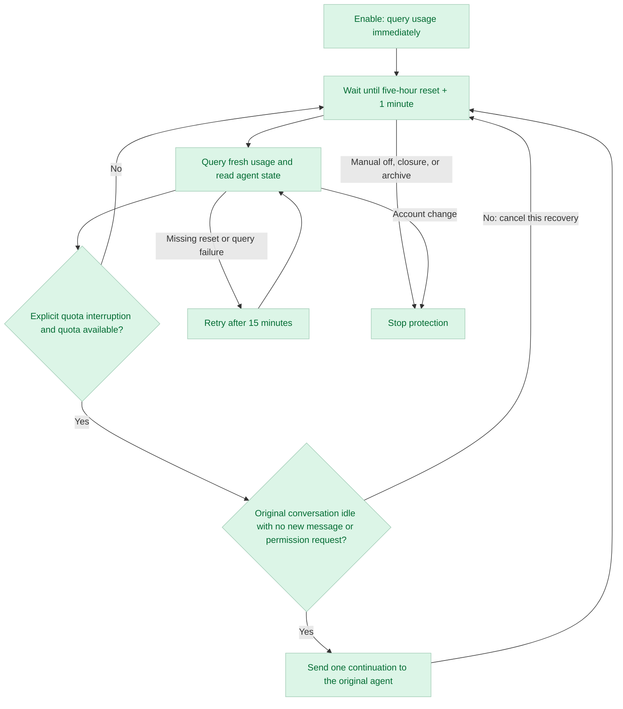

# Paseo Watchdog

[简体中文](README.md) · **English**

**Enable it once. Keep the conversation protected. Resume long tasks after quota recovery.**

Paseo Watchdog provides continuous quota recovery protection for Claude Code agents in [Paseo](https://paseo.sh). On enable, it reads quota and the actual five-hour reset time through Paseo Usage. It checks again about one minute after that reset. Only an explicitly recorded quota interruption with fresh available quota can send this message to the **original agent**:

> 继续当前未完成的任务。

The message means “Continue the current unfinished task.”

| Design                | Behavior                                                                                                                                                                    |
| --------------------- | --------------------------------------------------------------------------------------------------------------------------------------------------------------------------- |
| Simple                | Handles explicit quota failures. Creates no new agents, branches, or task orchestration.                                                                                    |
| Under your control    | Off by default. Enable it for one agent, inspect its status, or cancel it. Protection stays enabled across turns; each quota interruption submits at most one continuation. |
| Conservative recovery | Requires an explicit quota failure and fresh available quota. Stale, missing, or uncertain data never authorizes a resume.                                                  |
| Quiet while waiting   | No usage polling between known resets. No test messages to Claude or model calls while waiting.                                                                             |

## Quick start

Requires **Paseo daemon and client 0.12.0+**, a Claude Code agent, and a working `paseo` CLI in the daemon environment. Only `provider=claude` is supported. Codex, API key quotas, proxy gateways, and custom providers are outside the current scope.

Select the target host under **Settings → Plugins**, enable plugins, then run this on the daemon machine:

```bash
paseo plugin install github:jiffies/paseo-watchdog
paseo plugin ls
```

Check that `paseo-watchdog` is `running` and enabled. Installation does not require `npm install`; Paseo provides the runtime dependencies. Installing a plugin means trusting its execution privileges on the daemon machine; see [Security boundaries](#security-boundaries).

<details>
<summary>Install from a local directory</summary>

Keep the source in a persistent directory on the daemon machine, then run:

```bash
paseo plugin install /absolute/path/to/paseo-watchdog
```

Alternatively, enter that absolute path in **Settings → Plugins → Plugin source** and select **Install plugin**. The path must exist on the daemon machine. [Paseo installation guide](https://paseo.sh/docs/plugins.md)

</details>

After starting a Claude task, enter this in the same agent's composer:

```text
/paseo-watchdog
```

Enable it for tasks that may run for tens of hours. Protection stays enabled after ordinary replies and can handle later quota interruptions too. Enable it before quota exhaustion when possible. You can also enable it after a failure if the agent is in the `error` state and its `lastError` contains a recognizable quota error.

## Three commands

| Command                                   | Purpose                                                                                |
| ----------------------------------------- | -------------------------------------------------------------------------------------- |
| `/paseo-watchdog` or `/paseo-watchdog on` | Enable continuous protection for the current agent.                                    |
| `/paseo-watchdog status`                  | Inspect monitoring status, usage, reset time, and the next check.                      |
| `/paseo-watchdog off`                     | Disable protection and cancel a pending resume. Submitted messages cannot be recalled. |

Paseo handles these commands in the client; they are not sent to Claude as conversation messages. Each command opens the status panel, which identifies its agent and refreshes cached status every three seconds. The button also refreshes cached status. Neither action queries Usage nor calls a model. Enabling protection starts the first Usage query immediately.

The panel also shows the current agent's **total trigger attempts, confirmed submissions, and failed or uncertain sends**, plus the latest 20 records with their trigger time, prompt, and result. In-flight requests are not counted as confirmed submissions. A confirmed submission means Paseo accepted the message, not that the task completed.

Totals cover the current plugin load and are not limited to the 20 retained records. Turning protection `off` and back `on` retains them. Reloading the plugin or restarting the daemon clears them; earlier sends are not reconstructed. Records contain only the plugin's fixed prompt and send status, with no conversation content or raw errors.

## How it works



Enabling protection immediately queries current usage and the actual five-hour reset timestamp. The next check runs **about one minute after that reset**, not five hours after enabling. There are no Usage queries in between, even if a quota failure arrives. Each check schedules the following window using its latest report. Missing or expired reset timestamps and query failures fall back to **15-minute** retries. Protection has no automatic expiry. A reset timestamp determines when to check; fresh quota data is still required before sending.

The query is:

```bash
paseo usage ls --agent YOUR_AGENT_ID --json --refresh
```

The initial query only fills the status panel and schedules a check; it never sends a continuation. At a later check, Watchdog resumes only an explicitly recorded quota interruption with available quota. It submits one ordinary continuation to the original agent and keeps the next window check scheduled. A failed or uncertain send is not retried for the same interruption.

Normal completion, manual cancellation of a turn, and unrelated errors clear the pending recovery without resuming those turns; the window timer stays active. Being idle alone is never a reason to resume. A new turn, new user message, or pending permission clears the old recovery request while retaining future protection. Manual `off`, agent closure or archive, and safety exceptions such as an account change disable protection.

## Safety controls

- **Verify the interruption and quota separately.** Paseo must report an explicit quota failure. At the scheduled check, five-hour usage must be `<= 95%` and every other reported window below `99%`. Since there is no mid-window polling, observing usage reach 100% is not required.
- **Treat unknown data as unknown.** A report must identify exactly one Claude account, with a fetch time no more than 10 minutes away from the current time. Missing or invalid percentages, or a previously exhausted window disappearing from the report, keep the monitor waiting. A detected account change stops it.
- **Check again before sending.** The agent is refreshed and cancellation state is checked immediately before submission, so a stale check cannot override a newly processed cancellation.
- **Keep existing permissions.** The continuation uses the original agent's permissions and execution mode. Watchdog does not approve tool permission requests or change permission modes.
- **Delegate credential handling.** The plugin does not directly read, store, or output Claude OAuth tokens. It uses Paseo's existing Usage capability and needs no separate API key.

### Security boundaries

Paseo plugins are **trusted, unsandboxed code** with the daemon user's privileges. These safeguards are application logic, not operating-system isolation. Paseo itself may read saved login information and contact usage services as part of its normal operation. [Paseo plugin trust model](https://paseo.sh/docs/plugins.md)

Reading remote state and sending a message are separate calls. A remote change between them may not be observed in time. `off` can cancel a pending resume, but cannot recall a message already submitted to the daemon.

Usage checks do not consume Claude conversation tokens, but do make usage-service requests. The resumed task consumes model quota normally and continues operating with the agent's existing permissions.

## Known limits

- Only explicit quota failures are handled. A silent stall, a lost lifecycle event, or a quota error reported as normal completion may not trigger a resume. Idle status alone cannot distinguish a finished task from a quota pause.
- Monitoring and trigger history live in memory. A daemon restart, plugin reload, or disable clears them; enable protection again manually.
- Each quota interruption submits at most one continuation; protection spans multiple quota windows. It does not drive a task that the model has normally finished, approve permissions, or retry unrelated errors.
- English and Chinese are available for the documentation. The panel, status messages, and continuation prompt currently use Chinese.
- Uses the 0.12 agent panel API, also retained in 0.13. Windows invokes the CLI through `cmd.exe`; Linux, WSL, and macOS invoke `paseo` directly. Windows and mobile UI behavior have not been verified on real devices.

## Troubleshooting

| Symptom                                      | What to check                                                                                                                    |
| -------------------------------------------- | -------------------------------------------------------------------------------------------------------------------------------- |
| Installation reports an incompatible version | Check the target daemon and client in Settings → About. Both need 0.12.0+.                                                       |
| Plugin is not running                        | Check `paseo plugin ls`, the plugin switches, and `paseo plugin logs paseo-watchdog`.                                            |
| Enabled, but no usage checks                 | Check the last query and next check timestamps. After the initial query, it waits until the scheduled reset check.               |
| Keeps waiting without resuming               | Inspect the status panel. A quota interruption must be recorded, and fresh quota data must be complete and valid.                |
| Usage query fails                            | Run the `paseo usage ls --agent ...` command above in the daemon environment and confirm the CLI can query that agent's account. |

Update a GitHub installation with `paseo plugin update paseo-watchdog`. After editing a local installation, use `paseo plugin reload paseo-watchdog`. Reloading clears existing monitoring.

## Development and contributions

Use **Node.js 24+** to check the source:

```bash
npm ci --ignore-scripts --no-audit --no-fund
npm run typecheck
npm test
```

Tests use simulated usage reports, agents, and timers. They cover initial usage display, reset scheduling without intermediate queries, stale panel updates, cancellation races, missing quota data, account changes, one send per interruption, more than 48 simulated hours across ten quota windows, and the 0.12 panel contract. Validation includes installation on a 0.12 daemon, type checks against 0.12/0.13, and simulated tests. A real Claude quota-exhaustion-to-recovery cycle has not yet been verified end to end.

Start with [server/watchdog.ts](server/watchdog.ts) for monitoring, [server/quota.ts](server/quota.ts) for quota decisions, [client/panel.tsx](client/panel.tsx) for the UI, and [shared/control.ts](shared/control.ts) for the RPC contract. This is an independent implementation with no dependency on another Auto Resume plugin.

[Issues](https://github.com/jiffies/paseo-watchdog/issues), compatibility fixes, bug fixes, and test improvements are welcome. Include Paseo versions, a sanitized error summary, and reproduction steps. Do not publish tokens, full credentials, or logs containing private information.

## License

Licensed under the [MIT License](LICENSE).
