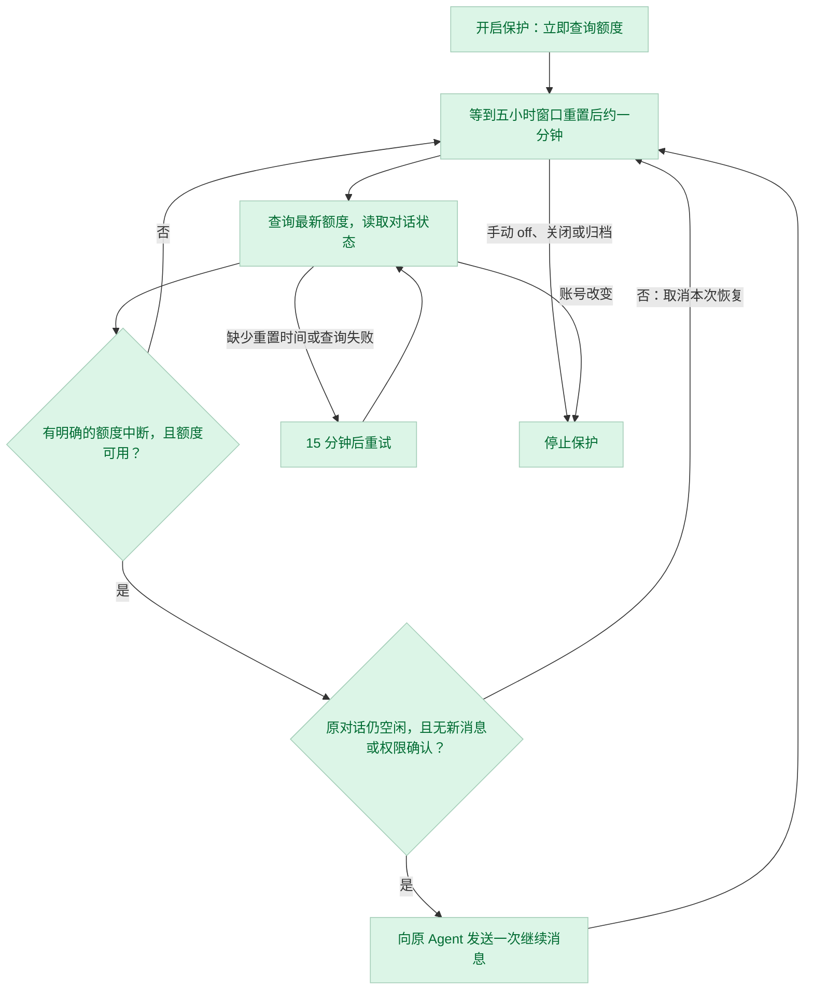

# Paseo Watchdog

**简体中文** · [English](README.en.md)

**开启一次，持续保护这个对话；额度刷新后自动继续长任务。**

Paseo Watchdog 为 [Paseo](https://paseo.sh) 中的 Claude Code Agent 提供持续的额度恢复保护。启用时，它通过 Paseo Usage 查询当前额度和实际五小时窗口重置时间，随后在重置后约一分钟再检查。只有记录到明确的额度中断，并确认同一账号的额度可用，才向**原 Agent** 发送一次：

> 继续当前未完成的任务。

| 设计     | 具体行为                                                                      |
| -------- | ----------------------------------------------------------------------------- |
| 简单     | 只处理明确的额度失败；不创建新 Agent、分支或任务编排。                        |
| 可控     | 默认关闭，按 Agent 手动开启；保护跨轮持续，每次额度中断最多提交一次继续消息。 |
| 保守恢复 | 必须有明确的额度错误及新的可用额度报告；数据过期、缺失或不确定时不发送。      |
| 低干扰   | 已知重置时间时，中间不查询额度；不向 Claude 发送测试消息，不调用模型。        |

## 快速开始

需要 **Paseo daemon 与客户端 0.12.0+**、Claude Code Agent，以及 daemon 环境中可运行的 `paseo` CLI。当前仅支持 `provider=claude`；不支持 Codex、API Key 额度、代理网关或自定义 provider。

在 **Settings → Plugins** 中选择目标主机，打开插件开关，然后在该 daemon 所在机器执行：

```bash
paseo plugin install github:jiffies/paseo-watchdog
paseo plugin ls
```

确认 `paseo-watchdog` 显示为 `running`，且插件开关已启用。安装无需 `npm install`；运行时依赖由 Paseo 提供。安装插件意味着信任它在 daemon 机器上的执行权限，详见下方[安全边界](#安全边界)。

<details>
<summary>从本地目录安装</summary>

把源码放在 daemon 机器的持久目录中，然后运行：

```bash
paseo plugin install /absolute/path/to/paseo-watchdog
```

也可以在 **Settings → Plugins → Plugin source** 填入该绝对路径，再点击 **Install plugin**。路径必须在 daemon 所在机器上存在。[Paseo 安装说明](https://paseo.sh/docs/plugins.md)

</details>

开始运行 Claude 任务后，在同一个 Agent 的对话框输入：

```text
/paseo-watchdog
```

适合预先开启后运行十几个小时或更久的任务。普通回复结束后保护仍会保持，后续再次遇到额度限制也会继续处理。建议在额度中断前开启。如果 Agent 已处于 `error` 状态，且 `lastError` 包含可识别的额度错误，也可以此时开启。

## 三个命令

| 命令                                      | 用途                                                   |
| ----------------------------------------- | ------------------------------------------------------ |
| `/paseo-watchdog` 或 `/paseo-watchdog on` | 为当前 Agent 开启持续保护。                            |
| `/paseo-watchdog status`                  | 查看监控状态、额度、重置时间和下次检查时间。           |
| `/paseo-watchdog off`                     | 关闭持续保护并取消待发送的恢复；已提交的消息无法撤回。 |

命令由 Paseo 客户端处理，不会作为对话发送给 Claude。每次命令会打开状态面板，显示所绑定的 Agent ID，并每 3 秒读取一次缓存状态。“刷新状态”按钮同样只读取缓存，不查询 Usage、不调用模型。开启保护时会立即发起第一次 Usage 查询。

面板还会显示当前 Agent 的**触发总次数、已确认提交次数、发送失败或结果未知次数**，以及最近 20 条记录的触发时间、提示词和发送结果。正在提交的请求不会提前计为成功；“已确认提交”表示 Paseo 已接收，不代表任务执行完成。

次数累计覆盖本次插件加载期间，不受 20 条明细上限影响。手动 `off` 后再次 `on` 会保留记录；插件重载或 daemon 重启后清空，不回溯此前的发送。记录只包含插件固定提示词和发送状态，不保存对话内容或原始错误。

## 工作流程



启用时立即查询额度和实际的五小时窗口重置时间，然后等到**该重置时间后约一分钟**再检查，并非从启用时重新计算五小时。中间不查询 Usage，出现额度失败也只记录原因、保留原定时。每次检查根据新报告安排下一个窗口。重置时间缺失、已过期或查询失败时，每 **15 分钟**重试。保护没有自动到期时间；到达重置时间不代表已经有可用额度，发送前仍需新的用量报告确认。

查询使用：

```bash
paseo usage ls --agent YOUR_AGENT_ID --json --refresh
```

首次查询只填充状态面板并安排检查，不发送继续消息。后续定时检查时，只有存在明确的额度中断记录且额度可用，才向原 Agent 提交一次普通继续消息，并保留下个窗口的检查。发送失败或结果未知时，不重发本次消息。

普通回复完成、主动取消某轮或非额度错误会清除待恢复请求，保留窗口检查，不会自动续跑这些轮次。仅仅处于空闲状态，不构成自动继续的理由。等待额度时检测到新轮次、新用户消息或待处理的权限确认，会清除旧恢复请求，保留后续保护。手动 `off`、Agent 关闭或归档，以及账号改变等安全异常才会关闭保护。

## 安全如何落实

- **分别确认中断原因与额度。** 必须有 Paseo 明确报告的额度错误；定时检查时，五小时使用率须为 `<= 95%`，且其他已报告窗口均低于 `99%`。因为中间不轮询，不要求恰好观察到使用率达到 100%。
- **未知数据不放行。** 报告必须来自唯一的 Claude 账号；数据时间与当前时间的偏差不得超过 10 分钟。窗口数值缺失、无效，或此前耗尽的窗口从报告中消失时，继续等待。检测到报告账号改变时停止监控。
- **发送前再检查。** 重新读取 Agent 状态，并在提交前核对监控是否已被取消，避免旧检查覆盖新的关闭操作。
- **不接管权限。** 继续消息沿用原 Agent 的权限和运行方式；插件不会批准工具权限请求或改变权限模式。
- **不自行管理凭据。** 插件不直接读取、存储或输出 Claude OAuth token；用量查询交给 Paseo 已有的 Usage 能力，也无需为插件单独配置 API Key。

### 安全边界

Paseo 插件是**受信任、无沙箱的代码**，运行时具有 daemon 用户的访问权限。上述保护来自插件逻辑，并非操作系统隔离；Paseo 自身仍可能按正常机制读取保存的登录信息、访问用量接口。[Paseo 插件信任模型](https://paseo.sh/docs/plugins.md)

读取远端状态与发送消息是两次独立调用，无法保证两者之间的远端变化都能及时被观察到。`off` 能取消尚未提交的恢复，不能撤回已交给 daemon 的消息。

用量查询不消耗 Claude 对话 token，但会产生用量接口请求；真正恢复任务后会正常消耗模型额度，Agent 也会按原有权限继续执行任务。

## 已知限制

- 仅处理明确的额度失败。静默停住、生命周期事件丢失，或额度错误被 Paseo 报告为正常完成，都可能不会触发自动恢复。只看“空闲”状态，无法可靠区分任务完成和额度暂停。
- 监控和触发记录只保存在内存中。daemon 重启、插件重载或禁用后，记录清空，需要重新手动开启保护。
- 每次额度中断最多提交一次继续消息；保护可覆盖多个额度窗口。它只恢复明确的额度中断，不会推动模型已正常结束的任务、自动批准权限或重试普通错误。
- 中英文支持指项目文档；当前状态面板和自动继续提示使用中文。
- 使用 0.12 的 Agent 面板接口，并兼容 0.13 保留的旧接口。Windows 使用 `cmd.exe` 调用 CLI，Linux、WSL 和 macOS 直接调用 `paseo`；Windows 和手机界面尚未完成实机验证。

## 排查问题

| 情况               | 检查方式                                                                                           |
| ------------------ | -------------------------------------------------------------------------------------------------- |
| 安装提示版本不兼容 | 在 Settings → About 核对目标 daemon 与客户端版本，均需 0.12.0+。                                   |
| 插件没有运行       | 查看 `paseo plugin ls`、插件开关，以及 `paseo plugin logs paseo-watchdog`。                        |
| 已开启但没有查询   | 查看上次查询和下次检查时间；首次查询后，会等到计划中的窗口重置检查。                               |
| 一直等待、不继续   | 查看状态面板；确认已记录额度中断，且新的用量报告完整、有效。                                       |
| Usage 查询失败     | 在 daemon 的同一环境运行上面的 `paseo usage ls --agent ...` 命令，确认 CLI 能查询该 Agent 的账号。 |

GitHub 来源的安装可用 `paseo plugin update paseo-watchdog` 更新。本地源码修改后，用 `paseo plugin reload paseo-watchdog` 重新加载；重载会清除现有监控。

## 开发与贡献

源码验证使用 **Node.js 24+**：

```bash
npm ci --ignore-scripts --no-audit --no-fund
npm run typecheck
npm test
```

测试使用模拟用量、Agent 和定时器，覆盖启用即查询、重置定时与中间不查询、面板旧状态刷新、取消竞态、额度缺失、账号变化、每次中断单次发送、模拟超过 48 小时和十个额度窗口，以及 0.12 面板接口。当前验证包括 0.12 daemon 安装运行、0.12/0.13 类型检查和模拟测试；尚未完成真实 Claude 额度耗尽到自动恢复的端到端验证。

核心逻辑在 [server/watchdog.ts](server/watchdog.ts)，额度判断在 [server/quota.ts](server/quota.ts)，界面在 [client/panel.tsx](client/panel.tsx)，RPC 契约在 [shared/control.ts](shared/control.ts)。这是独立实现，不依赖其他 Auto Resume 插件。

欢迎通过 [Issues](https://github.com/jiffies/paseo-watchdog/issues) 反馈问题，或提交兼容性、错误修复和测试改进。反馈时请附 Paseo 版本、错误摘要和复现步骤；不要公开 token、完整凭据或含私人信息的日志。

## 许可证

本项目采用 [MIT 许可证](LICENSE)。
